  

  

  

## 🛡️ Ficha do Herói

  

> Sou desenvolvedor de software com foco em **backend**. Construo e mantenho APIs e serviços com **C# e .NET**, adotando arquiteturas bem definidas e os princípios do **SOLID**. Modelo e consulto dados em **SQL Server** e **PostgreSQL**, também trabalho com **TypeScript** e **JavaScript**, tenho conhecimento em ferramentas da **AWS**, organizo as entregas pelo **Azure DevOps** e versiono código com **Git** no **Bitbucket** e no **GitHub**.

## 🏰 Jornada do Cavaleiro

  

## ⚔️ Arsenal

  

## 📊 Status do Cavaleiro

  
  

  

  

## 📯 Convocar o Cavaleiro

  
  
  

  

